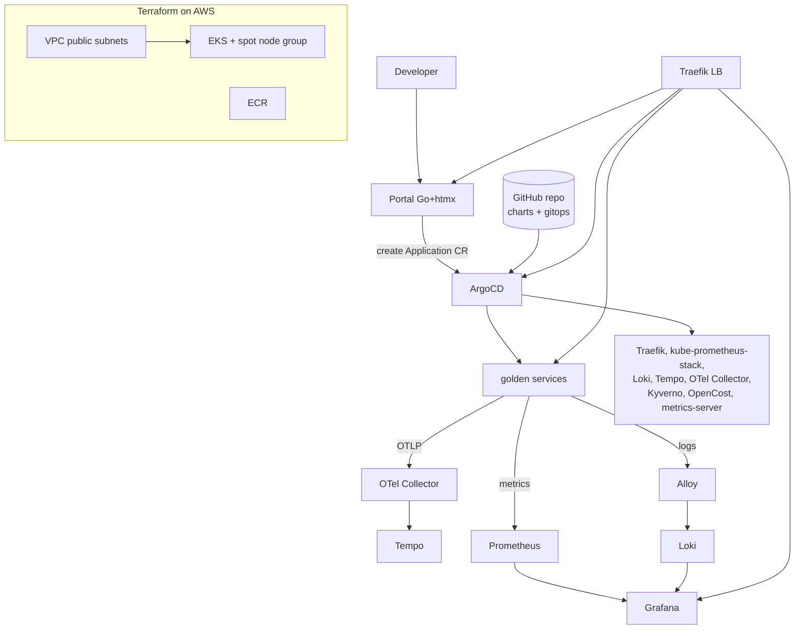

# Paved Road: a self-service internal developer platform

[](https://github.com/mini4141/paved-road-platform/actions/workflows/ci.yml)

Developers open a portal, pick a golden-path template and get a running, observable, autoscaled service on
Kubernetes through GitOps. They never touch YAML. Guardrails, cost visibility and reliability drills are built in.

- Evidence of it working (screenshots, logs, test reports): [`proof/README.md`](proof/README.md)
- Write-up with architecture, requirement table and lessons learned: [`docs/PORTFOLIO.md`](docs/PORTFOLIO.md)

## Architecture



One entry point (Traefik) serves the portal at `/`, Grafana at `/grafana`, ArgoCD at `/argocd` and every
service at `/svc/<name>/`. kind and EKS use the same manifests; the only differences are `values-eks.yaml` files.

## Repository layout

| Path | What |
|---|---|
| `portal/` | Go + `html/template` + htmx portal; creates ArgoCD `Application` objects with the dynamic client |
| `templates/` | Golden-path services: `go-http-service` (Go) and `node-http-service` (Node 24 + TypeScript) |
| `charts/golden-service/` | Shared chart: Deployment, Service, HPA, PDB, topology spread, ServiceMonitor, IngressRoute |
| `charts/portal/`, `charts/platform-observability/` | In-repo charts (portal; dashboards as code, alert rule, Grafana route) |
| `gitops/` | `root-app.yaml` (app-of-apps), ApplicationSet for add-ons, `addons/<name>/values-{common,kind,eks}.yaml` |
| `policies/` | Kyverno `ValidatingPolicy` guardrails, Kustomize base + enforce overlay, `kyverno test` cases |
| `infra/` | Terraform: `modules/{network,eks,ecr}`, `envs/showcase` |
| `bootstrap/` | Ansible playbook (`kubernetes.core`) that installs ArgoCD and applies the root app |
| `loadtest/`, `scripts/chaos.sh` | k6 smoke and scale tests; pod-kill, node-drain and GitOps-restore drills |
| `e2e/` | Playwright golden-path test and the proof screenshot script |
| `.github/workflows/` | `ci.yml` plus the reusable `reusable-build-test.yml` and `reusable-image-scan.yml` (Trivy) |

## Quickstart (local, kind)

Prerequisites: Docker Desktop, kind, kubectl, Helm, Go 1.25+, Node 24, k6. Ansible runs in a container.

```bash
cp .env.example .env            # optional; set KIND_HTTP_PORT if 8080 is busy
git push origin main            # ArgoCD reads the manifests from this public GitHub repo
scripts/dev-up.sh               # kind cluster, images, Ansible bootstrap, waits for every app to be Healthy
```

Then open `http://localhost:8080/` (portal), `/grafana/`, `/argocd/`. `scripts/seed.sh` (run by `dev-up.sh`)
creates the demo service `orders-api` through the portal.

```bash
scripts/test-all.sh                    # Go, Node, Terraform, kyverno, kubeconform
E2E=1 scripts/test-all.sh              # plus k6 smoke and Playwright (needs the running platform)
scripts/drill-hpa.sh                   # k6 load scales orders-api from 2 to >= 4 replicas
scripts/chaos.sh pod-kill orders-api   # also: node-drain, gitops-restore
scripts/capture-proof.sh phase1        # screenshots and logs into proof/phase1-local
scripts/dev-down.sh
```

## Deploy to AWS and destroy

Uses the AWS profile `paved-road-platform-deployer` in `ap-southeast-2` (never the default profile).

```bash
scripts/deploy.sh                      # terraform apply, push images to ECR, Ansible bootstrap, tests and drills
scripts/capture-proof.sh phase2
scripts/destroy.sh && scripts/verify-destroyed.sh
```

The showcase is meant to live under two hours: 2x `t3.large` SPOT nodes, one NLB, no NAT gateway, no volumes.
GitHub Actions only builds and tests; it never holds AWS credentials.

## Decisions

Design choices and deviations are logged one line each in [`docs/DECISIONS.md`](docs/DECISIONS.md). How AI tooling
was used and verified: [`docs/AI_USAGE.md`](docs/AI_USAGE.md).
