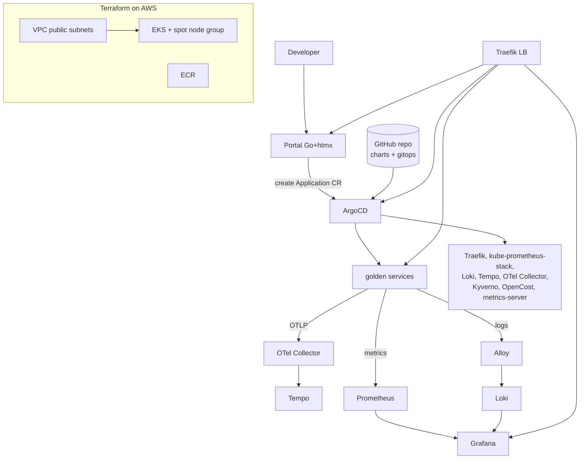

# SPECS.md: Paved Road Platform

## 1. Summary

This is a self-service internal developer platform (IDP) that turns three pieces into a working service in minutes:

- a **golden-path template**,
- a **Helm chart**, and
- a **GitOps** flow.

The infrastructure is built by Terraform modules on AWS, or runs on kind locally. Ansible bootstraps ArgoCD, and ArgoCD then installs the whole platform: ingress, metrics, logs, traces, policy and cost.

A Go + htmx portal lets a developer do four things: create a service, see its health, check its golden-signal dashboard and see its cost. Reliability drills show autoscaling, self-healing and disruption tolerance.

**Demo story:**
1. Create `orders-api` from the Go template in the portal.
2. ArgoCD syncs it, and it turns Healthy.
3. The Grafana dashboard shows its traffic, and logs and traces are linked.
4. A k6 load test scales it from 2 to 5 pods.
5. Killing pods doesn't break it.
6. OpenCost shows what it costs per hour.

## 2. Requirement coverage matrix

| Requirement | Covered by | Proof |
|---|---|---|
| Self-service developer platform, developer experience | F1 portal + F2 golden templates | Portal screenshots |
| Kubernetes clusters + cloud resources, performance/scalability/cost (FinOps) | Terraform EKS on spot, HPA, OpenCost (F5) | Terraform outputs, HPA scale log, cost panel |
| CI/CD pipelines, GitOps workflows, reusable templates | Reusable GH Actions workflows, ArgoCD app-of-apps/ApplicationSet (F3) | CI runs, ArgoCD tree screenshot |
| Fault tolerance, disaster recovery, scaling | F6 chaos drills, GitOps rebuild drill (delete namespace → ArgoCD restores), PDB + topology spread | Drill logs |
| Observability stack (Prometheus, Grafana, ELK/OTel) | F4: Prometheus/Grafana/Loki/Tempo/OTel Collector | Grafana screenshots |
| IaC: Terraform or Ansible | Terraform modules + Ansible bootstrap | Plan/apply logs, playbook log |
| Measure what matters, gradual change, automation to reduce toil | Platform SLO dashboard, Kyverno guardrails in `Audit` then `Enforce` mode | Policy report |

## 3. Architecture



## 4. Repository layout

```
infra/                    Terraform: modules/{network,eks,ecr}, envs/showcase/
bootstrap/                Ansible: site.yml, roles/argocd, inventory (localhost + kubeconfig)
gitops/                   root-app.yaml, applicationsets/addons.yaml, addons/<name>/values-{kind,eks}.yaml
charts/golden-service/    shared Helm chart (Deployment, Service, HPA, PDB, ServiceMonitor, IngressRoute)
templates/go-http-service/  templates/node-http-service/   golden-path sample apps
portal/                   Go portal (cmd/, internal/, web/templates)
policies/                 Kyverno ClusterPolicies + kyverno tests
loadtest/                 k6 scripts
.github/workflows/        ci.yml, reusable-build-test.yml, reusable-image-scan.yml
scripts/                  dev-up.sh (kind), deploy.sh (EKS), destroy.sh, chaos.sh, capture-proof.sh, ...
```

## 5. Features (end-to-end)

### F1: Self-service portal
- Pages: **Catalog** (all portal-managed services with ArgoCD sync and health status, replicas, links), **Create service** (a form with name, template `go-http`/`node-http`, team label, replicas, autoscaling on/off, max replicas), **Service detail** (status, recent events, Grafana dashboard link, cost/hour, scorecard).
- Create flow: the form posts to the portal, which validates the name and creates an ArgoCD `Application` (source = `charts/golden-service` in this repo, Helm params = image, team, replicas, HPA). ArgoCD syncs and the portal polls the status (htmx `hx-trigger="every 3s"`) until it shows **Healthy**.
- **Accept:** create `orders-api`, and it is reachable at `/svc/orders-api/` through Traefik within 2 minutes.

### F2: Golden-path templates
- Each template is a tiny HTTP service with `/`, `/healthz` and `/work?ms=` (CPU work, for load tests). It has Prometheus metrics, OTel traces, JSON logs, a multi-stage Dockerfile and a CI workflow that **calls the reusable workflows**.
- **Accept:** both template images build in CI. Locally, `scripts/dev-up.sh` builds and `kind load`s them.

### F3: GitOps platform bootstrap
- The Ansible playbook installs ArgoCD (Helm) and applies the root app. The root app creates an ApplicationSet that generates one Application per `gitops/addons/*` folder.
- **Accept:** every add-on Application is Synced/Healthy, as shown by the `argocd app list` output and a screenshot of the ArgoCD UI tree.

### F4: Observability
- The Grafana dashboards are provisioned as code:
  - "Platform overview": nodes, pods, CPU/mem, cost.
  - "Service golden signals": RPS, errors, p95 latency per service.
  - "Platform SLO": the API availability of golden services against a 99.5% target, with a burn-rate panel.
- A Loki logs panel and Tempo traces are linked from exemplars.
- An Alertmanager rule `GoldenServiceHighErrorRate` routes to a null/webhook receiver that logs.
- **Accept:** after the load test the dashboards show non-empty data, and one trace opens in Tempo.

### F5: FinOps
- OpenCost runs with its default pricing (or AWS pricing on EKS). The portal shows the cost per hour for each service, read from the OpenCost API. The Platform dashboard shows the cost per namespace.
- **Accept:** the service detail page shows a non-zero cost figure.

### F6: Reliability drills
- `loadtest/k6-scale.js` ramps up to drive the HPA from 2 to ≥ 4 replicas. The test logs the replica count over time.
- `scripts/chaos.sh pod-kill orders-api`: k6 smoke error rate stays below 1%, and pods are replaced.
- `scripts/chaos.sh node-drain` (EKS only): the PDB keeps at least one pod available during the drain.
- `scripts/chaos.sh gitops-restore`: `kubectl delete ns orders-api`, and ArgoCD recreates it (self-heal).
- **Accept:** each drill writes a log with the before/after state and PASS.

### F7: Guardrails
- Kyverno policies: `require-requests-limits`, `require-team-label`, `disallow-latest-tag`. A bad manifest from `policies/tests/bad-deployment.yaml` is rejected.
- **Accept:** `kyverno test` passes, and the deliberate bad apply is denied, captured in a log.

## 6. Data model

There's no database: state lives in Kubernetes. The portal labels everything it creates with `paved-road/managed=true` and `paved-road/team=<team>`, and lists Applications by that label.

## 7. Interfaces

Portal HTTP routes:
- `GET /`
- `GET /services`
- `GET /services/new`
- `POST /services`
- `GET /services/{name}`
- `GET /services/{name}/status` (htmx partial)
- `DELETE /services/{name}`
- `GET /healthz`

## 8. Test plan

| Layer | Test |
|---|---|
| Go | Handler test for `POST /services` with a fake dynamic client (asserts the Application spec) |
| Terraform | `fmt -check`, `validate`, `tflint` in CI |
| Manifests | `helm template` + `kubeconform` for the chart and add-on values |
| Policies | `kyverno test policies/` |
| e2e | Playwright: create a service in the portal → wait for Healthy → open the service URL |
| Load | k6 smoke: p95 < 500 ms, errors < 1% |

## 9. Phase 1: Local

**Run:** `scripts/dev-up.sh` does the following:
1. Creates the kind cluster (1 control plane + 2 workers, port 8080).
2. Builds and loads the images.
3. Runs the Ansible bootstrap.
4. Waits for every app to be Healthy.
5. Prints the URLs.

**Proof checklist:**
- [ ] `logs/argocd-app-list.txt`, `logs/ansible-bootstrap.log`, `logs/kubectl-get-all.txt`
- [ ] `screenshots/01-portal-catalog.png`, `02-portal-create.png`, `03-service-healthy.png`, `04-argocd-tree.png`, `05-grafana-golden-signals.png`, `06-grafana-slo.png`, `07-loki-logs.png`, `08-tempo-trace.png`, `09-cost-panel.png`
- [ ] `logs/drill-hpa.log`, `logs/drill-pod-kill.log`, `logs/drill-gitops-restore.log`, `logs/kyverno-deny.log`
- [ ] `tests/`: Go, kyverno, kubeconform and Playwright reports

## 10. Phase 2: AWS

| Local | AWS |
|---|---|
| kind | EKS (latest supported version), managed node group 2× t3.large SPOT, public subnets, access entries (API auth mode) |
| `kind load` images | ECR repos `portal`, `go-http-service`, `node-http-service` |
| localhost:8080 | Traefik Service of type LoadBalancer (NLB), reached through its DNS name |
| OpenCost default pricing | OpenCost with AWS on-demand/spot pricing |

`scripts/deploy.sh`:
1. `terraform apply`.
2. `aws eks update-kubeconfig`.
3. Build and push the images.
4. Run the Ansible bootstrap with the `eks` overlay.
5. Wait for Healthy.
6. Run the portal e2e and the drills, including `node-drain`.

**Proof checklist:**
- [ ] `logs/terraform-apply.log` (redacted), `resources.txt`
- [ ] `screenshots/01-eks-portal-catalog.png`, `02-eks-service-healthy.png`, `03-eks-argocd-tree.png`, `04-eks-grafana.png`, `05-eks-cost.png`
- [ ] `logs/drill-node-drain.log`, `logs/drill-hpa.log`
- [ ] `tests/playwright-eks/`

## 11. Phase 3: Destroy

`scripts/destroy.sh`:
1. Delete the ArgoCD Applications with `--cascade`.
2. Delete the `traefik` Service and wait until `aws elbv2 describe-load-balancers` shows no NLB for the cluster VPC.
3. Delete the ECR images.
4. `terraform destroy`.

`scripts/verify-destroyed.sh` also checks that `aws eks list-clusters` is empty for the project, and that no ELBs, EBS volumes or ENIs remain in the VPC (and that the VPC itself is gone).

## 12. Out of scope

Multi-cluster, SSO for the portal, Backstage, cert-manager/TLS, and durable storage for observability.
