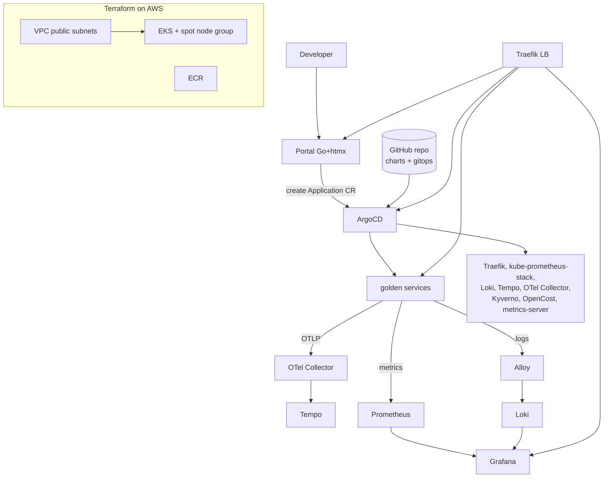
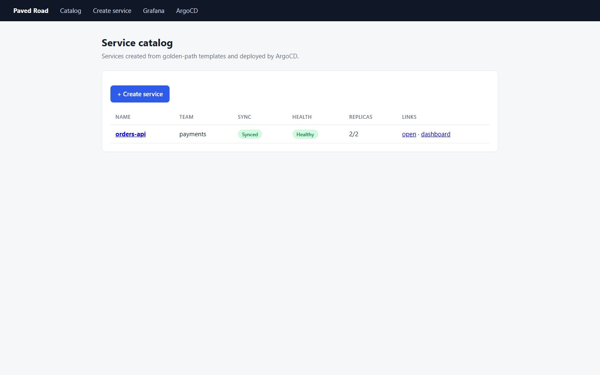
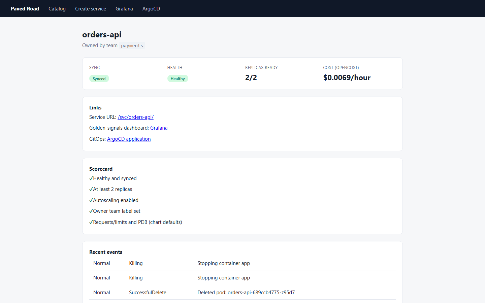
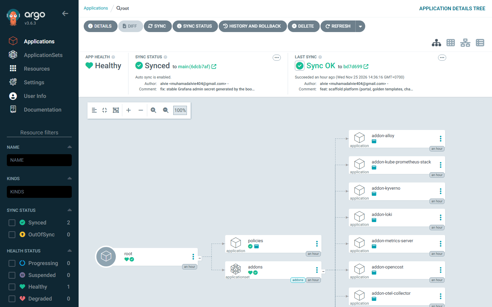
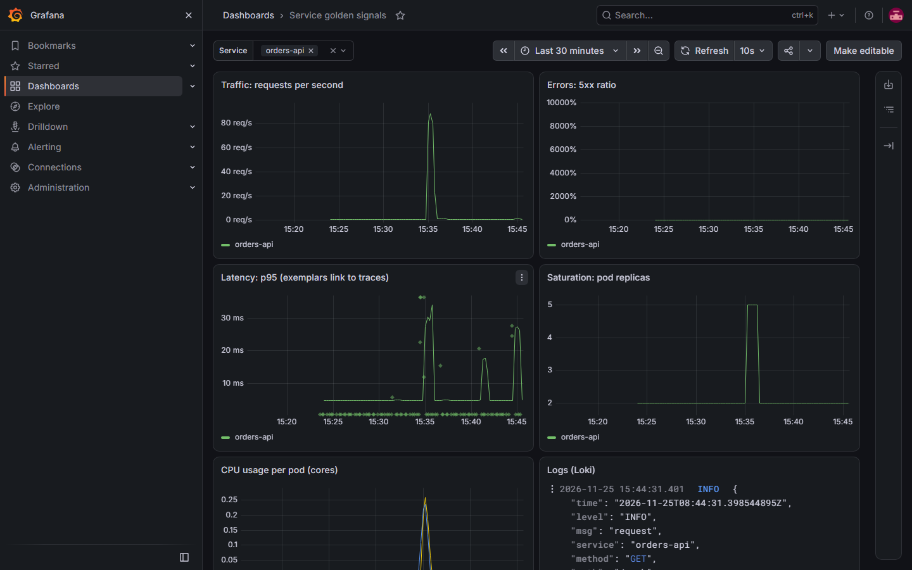
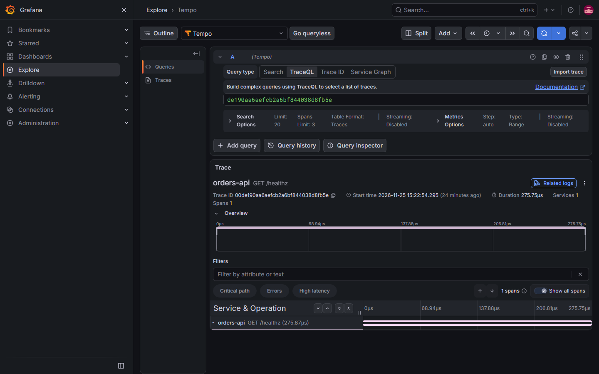
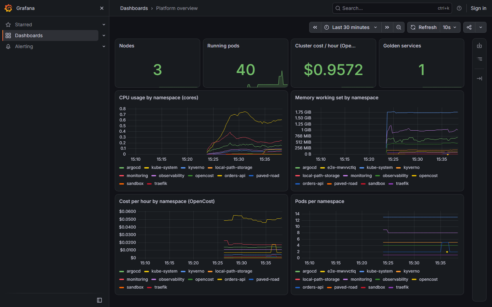
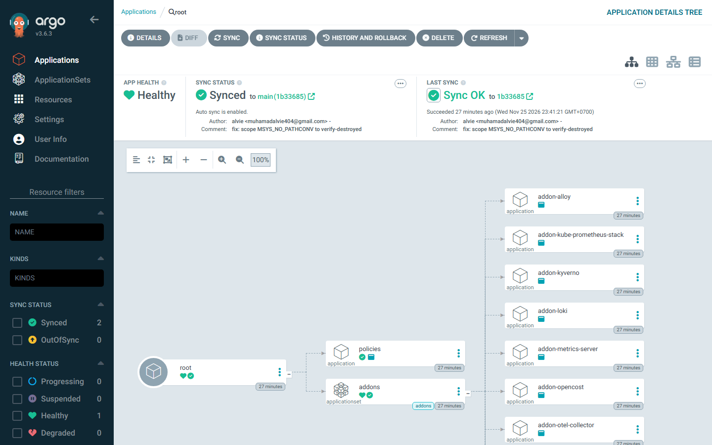
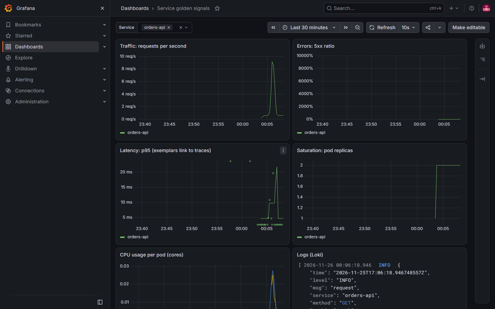
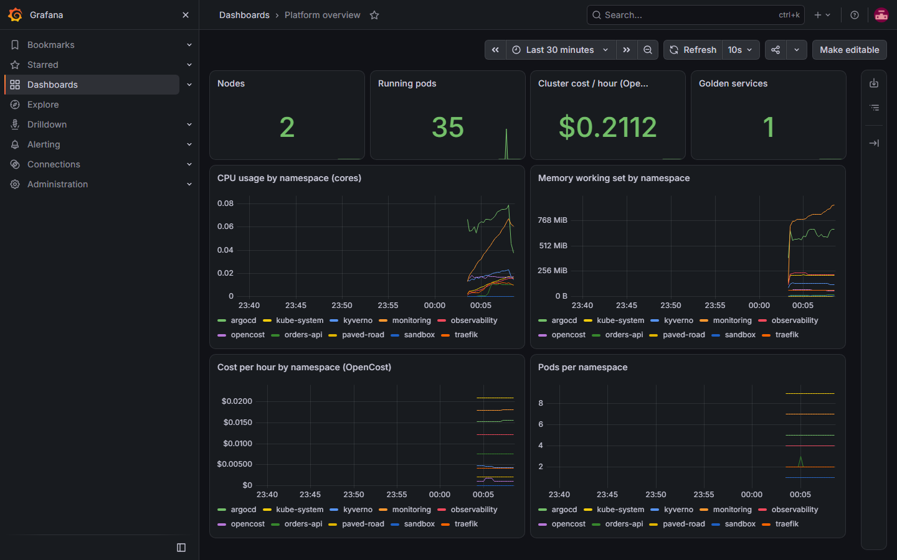

# Paved Road: a self-service internal developer platform on Kubernetes

> Developers open a portal, pick a golden-path template and get a running, observable, autoscaled service on
> Kubernetes through GitOps. They never touch YAML. Guardrails, cost visibility and reliability drills are built in.

Source: <https://github.com/mini4141/paved-road-platform> · Evidence: [`proof/README.md`](../proof/README.md)

## The problem

Every team that ships to Kubernetes re-solves the same things: a Deployment that is safe to run (requests, limits,
probes, disruption budgets, autoscaling), ingress, metrics, logs, traces, a dashboard, a cost number and a policy
gate. Done by hand, each service drifts and the platform team becomes a ticket queue.

A *paved road* removes that toil. One shared Helm chart encodes the safe defaults, two golden-path templates
(Go and Node 24 + TypeScript) come pre-instrumented, and a small portal turns "create a service" into a form.
ArgoCD does the deploying, so every change is declarative and recoverable.

**Demo story, as it actually ran** (local on kind, then on EKS):

1. Create `orders-api` from the Go template in the portal.
2. ArgoCD syncs it and it turns Healthy; Traefik serves it at `/svc/orders-api/`.
3. Grafana shows its traffic, latency (with exemplars), logs and traces, all linked.
4. A k6 load test scales it from 2 to 5 pods through the HPA.
5. Killing pods, draining a node or deleting its namespace does not break it.
6. OpenCost shows what it costs per hour, in the portal and in Grafana.

## Architecture



Key design choices:

- **Local first, same manifests.** kind and EKS consume the same charts; the only differences are
  `gitops/addons/<name>/values-eks.yaml` files (for example Traefik is a NodePort on kind and an NLB on EKS).
- **App-of-apps plus an ApplicationSet.** Ansible installs ArgoCD and applies one root Application. The root creates
  an ApplicationSet that generates one Application per `gitops/addons/*/addon.json` for every cluster labelled
  `paved-road/cluster=true`; the env (`kind`/`eks`) and the image registry come from the cluster secret, so no
  account ID is ever committed.
- **The portal never writes to Git.** It creates ArgoCD `Application` objects pointing at `charts/golden-service`
  with the user's values inlined as Helm parameters, so self-service needs no Git credentials.
- **One load balancer.** Traefik serves the portal at `/`, Grafana at `/grafana`, ArgoCD at `/argocd` and every
  service at `/svc/<name>/`.
- **Guardrails in two steps.** Kyverno policies audit every non-system namespace and deny in namespaces the portal
  manages (Kustomize base plus an enforce overlay), so teams see violations before they are blocked.

## Stack to requirement

| Requirement | Technology | Where | Proof |
|---|---|---|---|
| Self-service developer platform | Go 1.25 portal, `html/template`, htmx, client-go dynamic client | `portal/` | `01`-`03` portal screenshots, Playwright e2e |
| Golden templates | Go and Node 24 + TS services with Dockerfile, OTel, Prometheus, JSON logs; shared Helm chart | `templates/`, `charts/golden-service/` | template tests, `03-service-healthy.png` |
| Kubernetes | kind (local), Amazon EKS, Helm 3, Kustomize, metrics-server, HPA, PDB, topology spread | `charts/`, `gitops/`, `policies/overlays/` | `drill-hpa.log`, `drill-node-drain.log` |
| IaC | Terraform >= 1.9 modules `network`, `eks`, `ecr`; tflint; `fmt`/`validate` | `infra/` | `terraform.log`, `terraform-apply.log` |
| Cluster bootstrap | Ansible playbook with the `kubernetes.core` collection | `bootstrap/` | `ansible-bootstrap.log` |
| GitOps | ArgoCD app-of-apps, ApplicationSet, Applications created by the portal | `gitops/` | `04-argocd-tree.png`, `argocd-app-list.txt` |
| Ingress | Traefik (official chart), path routing; NLB on EKS (blocked by an account restriction, see below) | `gitops/addons/traefik/` | `01`-`03` EKS screenshots via port-forward |
| Observability | kube-prometheus-stack, Loki + Alloy, Tempo, OpenTelemetry Collector, dashboards as code | `gitops/addons/`, `charts/platform-observability/` | `05`-`08` Grafana screenshots |
| Guardrails | Kyverno: requests/limits, team label, no `latest` tag | `policies/` | `kyverno.log`, `kyverno-deny.log` |
| FinOps | OpenCost in the portal and Grafana; spot nodes; right-sized requests | `gitops/addons/opencost/` | `09-cost-panel.png`, `05-eks-cost.png` |
| CI/CD | GitHub Actions CI plus reusable build-test and Trivy image-scan workflows used by the templates | `.github/workflows/` | green CI on `main` |
| Load and chaos | k6 smoke and scale tests; pod-kill, node-drain and GitOps-restore drills | `loadtest/`, `scripts/chaos.sh` | `drill-*.log` |
| AWS | VPC (public subnets), EKS with a SPOT managed node group, ECR, IAM/OIDC, CloudWatch, NLB | `infra/` | `resources.txt` |

## Screenshots

| | |
|---|---|
|  |  |
|  |  |
|  |  |

On EKS: 




## What was hard

- **Kyverno 1.20 removed legacy policies.** `ClusterPolicy` objects are no longer accepted, so the guardrails are CEL
  `ValidatingPolicy` objects. Audit-everywhere plus enforce-in-managed-namespaces is done with two Kustomize layers,
  because the new API has no per-namespace action override.
- **Strict chart schemas.** Traefik 43 rejects unknown values, so the portal-only `paved.registry` parameter is
  injected with an ApplicationSet `templatePatch` instead of for every add-on.
- **Sync deadlocks on a small control plane.** A kind control plane saturated by ~13 add-ons restarted its scheduler
  and controller manager during the first sync; stuck sync operations had to be cleared and re-run.
- **Pod-kill was not free at first.** The first drill showed 1.5% errors because requests still reached a terminating
  pod. A 5 s shutdown delay plus a Traefik retry middleware brought it to 0%.
- **Random Grafana admin passwords** regenerate on every Argo sync and lock the admin out; the bootstrap now creates
  the Secret once.
- **The AWS account cannot create load balancers** (`OperationNotPermitted`), so the Traefik Service never got its
  NLB. The EKS tests, drills and screenshots went through `kubectl port-forward` to Traefik. The manifests are
  unchanged, so the NLB path works as soon as the account restriction is lifted.
- **Windows tooling friction.** Docker Desktop stopped mid-deploy once, Git Bash rewrites path arguments for native
  `.exe` files, and a stale kubeconfig from a destroyed cluster pointed at a dead endpoint; each fix is in the scripts.

## Approximate AWS cost

Two EKS runs (the first was aborted and destroyed), about 1.7 cluster-hours in total in `ap-southeast-2`:
EKS control plane at $0.10/h, 2x `t3.large` SPOT nodes at roughly $0.07/h combined, no NAT gateway, no load balancer
(the account could not create one), no volumes, ECR and CloudWatch negligible. Estimated total: **under $1**.
Everything was destroyed and `proof/phase3-destroy/verify-destroyed.txt` confirms nothing billable remains.

## How to reproduce

```bash
git clone https://github.com/mini4141/paved-road-platform && cd paved-road-platform
scripts/dev-up.sh        # local: kind + Ansible + ArgoCD + everything else
scripts/test-all.sh      # E2E=1 adds Playwright and k6
scripts/deploy.sh        # AWS: Terraform, ECR push, Ansible bootstrap, tests and drills
scripts/destroy.sh && scripts/verify-destroyed.sh
```
